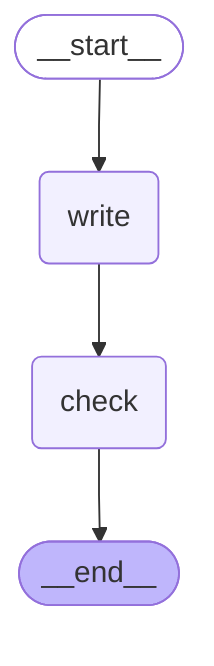

# Book Teller

Book Teller turns a book into a podcast series: the book told well by one voice, about 30 minutes an episode, in English.

Every script will be checked against the book, and for each fault the checker will show the line of the book that proves it.

**Status:** the skeleton, its pipeline, its cloud, and the call to the model. The app shows one page and answers one health address; it tells no book yet. The code that calls the model exists and is tested, but no page uses it yet. It runs on Azure, and a merge to `main` deploys it. See [the plan of milestone 1](docs/plans/2026-11-14-milestone_1_the_whole_path_once/plan.md). Before the app there was a probe, a small early test: can the model find faults that were planted in a script? See [its plan](docs/plans/2026-11-13-probe_planted_faults/plan.md) and [its code](experiments/2026-11-13-probe_planted_faults/).

## Run it

You need [Docker](https://docs.docker.com/get-docker/).

```
docker compose up --build
```

Then open <http://localhost:8000>. The address <http://localhost:8000/health> answers `{"status":"ok"}`.

A change to the page, `backend/src/book_teller/static/index.html`, shows after a reload of the browser, with no new build: `compose.yaml` puts the folder `backend/src` into the running container. A change to the Python code needs a restart: `docker compose restart`.

## The folders

| Folder | What it holds |
|---|---|
| `backend/` | The Python project: the web app, its tests, its lockfile and its Dockerfile |
| `infra/` | The cloud, as one Terraform file, with its tests and its lockfile |
| `scripts/` | Scripts for the whole repository. Today one: the smoke test of the image |
| `docs/plans/` | One plan for each piece of work |
| `docs/guides/` | What lasts after a piece of work: e.g. how to set up the project from zero |
| `experiments/` | One-time experiments, kept as they were run. Each folder has the name of its plan folder in `docs/plans/` |

## Run the checks

You need [uv](https://docs.astral.sh/uv/). It installs Python and the libraries at the exact versions of the lockfile, `backend/uv.lock`. Run the commands inside the folder `backend`.

```
cd backend
uv sync --locked
uv run pytest
uv run ruff check
uv run ruff format --check
uv run mypy
```

The tests need no network. `ruff` is the linter and the formatter; `mypy` is the type checker.

The smoke test needs Docker and curl, and the ports 8000 and 8001 free. It builds the image, starts it, and asks it a few questions: does it answer, and does it run as a user with no special rights? Run it from the top folder:

```
bash scripts/smoke_test.sh
```

## The model call

Every call to the model goes through one file, [backend/src/book_teller/model_call.py](backend/src/book_teller/model_call.py). It uses LangChain's model class and writes out each choice that the class would otherwise make by itself: which of OpenAI's two APIs, the strict shape of the answer, how much the model thinks, the timeout, and the number of tries. Whatever goes wrong, the caller gets one error with one of six reasons. The tests put a fake in the place of the network, so they read the real request and cost nothing. Why each choice was made, and what was measured: [the plan of that task](docs/plans/2026-11-24-model_call/plan.md).

**No key.** The code logs in to Azure as whoever runs it: on a developer's machine the login of the Azure CLI, in the cloud the identity of the app. That login needs the role "Cognitive Services OpenAI User" on the model resource; being its owner is not enough.

**The settings** come from environment variables. Their names are in [backend/.env.example](backend/.env.example). Copy that file to `backend/.env`, which git never sees, and fill in the address of your model service and the name of your deployment.

**To measure what a thinking setting costs,** run this inside the folder `backend`. It makes one real call for each setting that is named, so it costs money: about one US cent a call.

```
PYTHONPATH=src uv run --env-file .env python -m book_teller.measure --thinking low medium
```

With `--show` it also prints each request and each answer, made short.

## The two steps

An episode is made in two steps, and each step is one model call. The first writes the script from a chapter. The second checks that script against the chapter and lists every fault that it finds, each with the words of the chapter that prove it. [LangGraph](https://docs.langchain.com/oss/python/langgraph/overview) runs the steps and carries the data from one to the next. The whole graph is one file, [backend/src/book_teller/episode.py](backend/src/book_teller/episode.py). This picture is printed by the library from that code, and a test holds that the two stay the same:



- **The state** is what the steps share: the chapter, the script, the faults, and what each call cost.
- **A step that fails is tried once more,** but only after a timeout, "too many requests" or an error of the service. A second try cannot mend a refused login or an answer in the wrong shape. One weak spot: "an error of the service" is the reason for everything else that goes wrong, so a request that the service does not accept is tried a second time too, for nothing.
- **Nothing is saved between the steps yet.** A run that fails starts again from the first step.
- **The tests hand the graph a fake "ask the model",** so they need no network and cost nothing.

Two steps do not need a graph. The whole book of the next milestone does: a run must go on after a failure. Why each choice was made, and what the first real runs showed: [the plan of that task](docs/plans/2026-11-25-two_step_graph/plan.md).

**To tell one chapter,** run this inside the folder `backend`, with the settings of "The model call". It makes two real calls, so it costs money: about one or two US cents.

```
PYTHONPATH=src uv run --env-file .env python -m book_teller.tell ../experiments/2026-11-13-probe_planted_faults/chapter.txt
```

It prints the script, the faults and the cost of each step. A try that failed is not in that cost. With `--picture` and no file it asks no model and prints the picture above.

## How a change gets in

Every change reaches `main` by a pull request. A pipeline, [azure-pipelines.yml](azure-pipelines.yml), runs on it: the tests, the three checks and the smoke test, on a fresh machine in Azure Pipelines. A ruleset on GitHub refuses the merge while a step fails, and refuses a push straight to `main`, also from the owner. The repository takes no pull requests from outside.

The pipeline runs in a private project of Azure DevOps, because Microsoft no longer offers public ones. So a visitor sees on each pull request whether the run passed, but cannot open its full log.

**A merge deploys.** After a merge, the same run goes on: it pushes the image that the smoke test checked to the registry, named by the id of the merge commit; it tells the app to run that image; and it asks the live app `/health` until it answers. A run on a pull request skips these steps. The pipeline logs in to Azure with no stored secret (workload identity federation), and its rights reach only the resource group of the app.

## The cloud

The cloud is one Terraform file, [infra/main.tf](infra/main.tf): a resource group, a container registry with no admin user, a log workspace with a daily cap, a managed identity for the app with the one role `AcrPull` on the registry, a Container Apps environment, and the app, with zero copies when nobody visits. So the app pulls its image with no password.

The maintainer runs Terraform from their own machine, with their own Azure login; the pipeline only checks the file. The state file, Terraform's record of what it made, stays on that machine and is never committed: it can hold secrets. Terraform leaves the image of the app to the pipeline.

The tests of the file use a stand-in for Azure, so they need no login. Run them in the folder `infra`, after `terraform init`:

```
terraform test
```

How to make the cloud, and the settings that exist only in web pages: [docs/guides/setup-from-zero.md](docs/guides/setup-from-zero.md).

## How it is built

The project is built with a coding agent. How a change is made, and the merge rule: [CLAUDE.md](CLAUDE.md). What the agent may do: [.claude/settings.json](.claude/settings.json).

Licence: [MIT](LICENSE).
