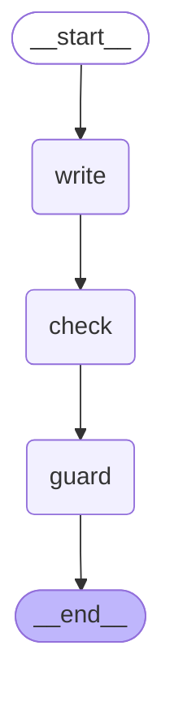

# Book Teller

Book Teller turns a book into a podcast series: the book told well by one voice, about 30 minutes an episode, in English.

Every script will be checked against the book, and for each fault the checker will show the line of the book that proves it.

**Status:** the skeleton, its pipeline, its cloud, the call to the model, the three steps of an episode, and the database. The app shows one page and answers one health address; it tells no book yet. The code that tells a chapter and saves the run exists and is tested, and a script runs it by hand, but no page uses it yet. It runs on Azure, and a merge to `main` deploys it. See [the plan of milestone 1](docs/plans/2026-11-14-milestone_1_the_whole_path_once/plan.md). Before the app there was a probe, a small early test: can the model find faults that were planted in a script? See [its plan](docs/plans/2026-11-13-probe_planted_faults/plan.md) and [its code](experiments/2026-11-13-probe_planted_faults/).

## Run it

You need [Docker](https://docs.docker.com/get-docker/).

```
docker compose up --build
```

It starts two containers: the app, and a PostgreSQL database beside it. The database takes no password and only your own machine can reach it. At its start the app makes its tables in that database.

Then open <http://localhost:8000>. The address <http://localhost:8000/health> answers `{"status":"ok"}`.

A change to the page, `backend/src/book_teller/static/index.html`, shows after a reload of the browser, with no new build: `compose.yaml` puts the folder `backend/src` into the running container. A change to the Python code needs a restart: `docker compose restart`.

## The folders

| Folder | What it holds |
|---|---|
| `backend/` | The Python project: the web app, its tests, its lockfile and its Dockerfile |
| `infra/` | The cloud, as one Terraform file, with its tests and its lockfile |
| `scripts/` | Scripts for the whole repository. Today one: the smoke test of the image |
| `docs/plans/` | One plan for each piece of work |
| `docs/guides/` | What lasts after a piece of work: e.g. how to set up the project from zero |
| `experiments/` | One-time experiments, kept as they were run. Each folder has the name of its plan folder in `docs/plans/` |

## Run the checks

You need [uv](https://docs.astral.sh/uv/). It installs Python and the libraries at the exact versions of the lockfile, `backend/uv.lock`. Some tests need a real PostgreSQL, so start the database first, from the top folder. Then run the other commands inside the folder `backend`.

```
docker compose up --detach db
cd backend
uv sync --locked
uv run pytest
uv run ruff check
uv run ruff format --check
uv run mypy
```

The tests need no internet, and no test asks a model. The tests of the database use a database of their own on the local server, `book_teller_test`, so they never touch the rows of the app. Without the local server those tests fail; they do not skip. `ruff` is the linter and the formatter; `mypy` is the type checker.

The smoke test needs Docker and curl, and the ports 8000, 8001 and 5432 free: stop your own `docker compose up` first, with `docker compose down`. It starts the image of the app and asks it a few questions: does it answer, does it run as a user with no special rights, and did it make its tables in an empty database? It does not build the image that it tests: you name the image, and the script prints its id and when it was made. So build the image again after each change. Run both from the top folder:

```
docker build --tag book-teller:candidate backend
bash scripts/smoke_test.sh book-teller:candidate
```

The second part of the script tests the app beside its database. There Docker Compose builds a second image of its own, which is thrown away.

## The model call

Every call to the model goes through one file, [backend/src/book_teller/model_call.py](backend/src/book_teller/model_call.py). It uses LangChain's model class and writes out each choice that the class would otherwise make by itself: which of OpenAI's two APIs, the strict shape of the answer, how much the model thinks, the timeout, and the number of tries. Whatever goes wrong, the caller gets one error with one of six reasons. The tests put a fake in the place of the network, so they read the real request and cost nothing. Why each choice was made, and what was measured: [the plan of that task](docs/plans/2026-11-24-model_call/plan.md).

**No key.** The code logs in to Azure as whoever runs it: on a developer's machine the login of the Azure CLI, in the cloud the identity of the app. That login needs the role "Cognitive Services OpenAI User" on the model resource; being its owner is not enough.

**The settings** come from environment variables. Their names are in [backend/.env.example](backend/.env.example). Copy that file to `backend/.env`, which git never sees, and fill in the address of your model service and the name of your deployment.

**To measure what a thinking setting costs,** run this inside the folder `backend`. It makes one real call for each setting that is named, so it costs money: about one US cent a call.

```
PYTHONPATH=src uv run --env-file .env python -m book_teller.measure --thinking low medium
```

With `--show` it also prints each request and each answer, made short.

## The steps of an episode

An episode is made in three steps. The first two are one model call each. The first writes the script from a chapter. The second checks that script against the chapter and lists every fault that it finds, each with the words of the chapter that prove it. The third has no model in it: plain code checks that list, see "The guard" below. [LangGraph](https://docs.langchain.com/oss/python/langgraph/overview) runs the steps and carries the data from one to the next. The whole graph is one file, [backend/src/book_teller/episode.py](backend/src/book_teller/episode.py). This picture is printed by the library from that code, and a test holds that the two stay the same:



- **The state** is what the steps share: the chapter, the script, the faults, and what each call cost.
- **A step that fails is tried once more,** but only after a timeout, "too many requests" or an error of the service. A second try cannot mend a refused login or an answer in the wrong shape. One weak spot: "an error of the service" is the reason for everything else that goes wrong, so a request that the service does not accept is tried a second time too, for nothing.
- **Nothing is saved between the steps yet.** A run that fails starts again from the first step.
- **The tests hand the graph a fake "ask the model",** so they need no network and cost nothing.

Three steps in a row do not need a graph. The whole book of the next milestone does: a run must go on after a failure. Why each choice was made, and what the first real runs showed: [the plan of that task](docs/plans/2026-11-25-two_step_graph/plan.md).

**To tell one chapter,** run this inside the folder `backend`, with the settings of "The model call". It makes two real calls, so it costs money: about one or two US cents.

```
PYTHONPATH=src uv run --env-file .env python -m book_teller.tell ../experiments/2026-11-13-probe_planted_faults/chapter.txt
```

It prints the script, the faults and the cost of each step. A try that failed is not in that cost. With `--picture` and no file it asks no model and prints the picture above.

## The guard

The checker is a model, and a model can make a quote up. So plain code checks every fault that the checker reports, in [backend/src/book_teller/guard.py](backend/src/book_teller/guard.py). The same input gives the same answer every time, and it costs nothing.

There are two checks:

- **The shape.** The answer must be a list of faults, each with a number for the sentence, one of six names for the kind, a number for the paragraph, a quote and a reason. Pydantic compares the answer with a class, inside the model call. An answer in another shape ends the run.
- **Each fault.** Its sentence number must point at a sentence of the script. Its quote must be in the chapter, inside one paragraph. The paragraph that the checker named is looked at first, then every other one. Both texts are cleaned before they are compared: small letters, plain quote marks, no underscores, single spaces. After that the quote must match letter for letter.

**A fault that fails the second check is not dropped.** It stays in the result, marked as not proven, with what is wrong: `no_such_sentence` or `quote_not_found`. A reader can then see everything that the checker said, and how far to trust each line.

**What "proven" does not mean:**

- The guard knows that the quote is in the chapter. It does not know whether the quote shows that the script is wrong.
- It sees only the faults that the checker reports, not the ones that the checker missed.
- **The quote is compared by letters, not by words.** So it may start or end in the middle of a word: the quote "he is not" is found in "she is nothing". A made-up quote that happens to be built of such pieces passes as proven.
- A true quote that the model copied with another kind of dash, or shortened with "..." in the middle, is marked as not found. A looser comparison would also pass a made-up quote that is close to a real sentence.
- Nothing limits the length of a chapter yet.

Why each choice was made: [the plan of that task](docs/plans/2026-11-25-guard/plan.md).

## The database

A run is kept in PostgreSQL, in two tables: `runs` (the chapter, the script, the status, and the sums of the tokens and the seconds) and `faults` (each fault of a run, with what the checker said and what the guard said). No page reads them yet; the script below writes them.

- **The tables are made by migrations:** files that change the tables, kept in git, in [backend/src/book_teller/migrations/versions](backend/src/book_teller/migrations/versions). The first one is plain SQL. [Alembic](https://alembic.sqlalchemy.org/) runs them and keeps in the database which one ran last, so none runs twice.
- **The code reads and writes through [SQLAlchemy](https://www.sqlalchemy.org/),** which maps each table to a class: [tables.py](backend/src/book_teller/tables.py). Saving and reading a run is one file, [runs.py](backend/src/book_teller/runs.py). A test compares the classes with the tables that the migrations make.
- **A container runs the migrations at its start,** before the app, when it is given the settings of a database: [start.py](backend/src/book_teller/start.py). If a migration fails, the new version does not start, and on Azure the old one keeps the visits.
- **No password, anywhere.** The local database asks for none. The server on Azure takes only logins of Microsoft Entra: the app asks Azure for a token, as its managed identity, and sends it where a password would go. See [database.py](backend/src/book_teller/database.py).

**Known limits.** On Azure the app is an administrator of its database, because it changes its own tables; a team would give it a smaller login and run the migrations with a second one. The connection to Azure is encrypted, but the server's certificate is not checked. A failed run is saved with a cost of 0.

**To tell one chapter and save the run,** add `--save` to the command of "The steps of an episode", with the local database running and its three settings in `backend/.env`:

```
PYTHONPATH=src uv run --env-file .env python -m book_teller.tell --save ../experiments/2026-11-13-probe_planted_faults/chapter.txt
```

It prints the number of the saved run. To read it with plain SQL:

```
docker compose exec db psql -U postgres -d book_teller -c "SELECT id, status, tokens_in, tokens_out FROM runs"
```

Why each choice was made, and what a second agent's review changed: [the plan of that task](docs/plans/2026-11-26-database/plan.md).

## How a change gets in

Every change reaches `main` by a pull request. A pipeline, [azure-pipelines.yml](azure-pipelines.yml), runs on it, on a fresh machine in Azure Pipelines: the tests, the three checks, the build of the image, and the smoke test of that image. A ruleset on GitHub refuses the merge while a step fails, and refuses a push straight to `main`, also from the owner. The repository takes no pull requests from outside.

The pipeline runs in a private project of Azure DevOps, because Microsoft no longer offers public ones. So a visitor sees on each pull request whether the run passed, but cannot open its full log.

**A merge deploys.** After a merge, a new run does the same steps on `main` and then goes on: it pushes the image that it built and that the smoke test checked, taken by its id (the fingerprint of its content), to the registry, named by the id of the merge commit; it tells the app to run that image; and it asks the live app `/health` until it answers. A run on a pull request skips these steps. The pipeline logs in to Azure with no stored secret (workload identity federation), and its rights reach only the resource group of the app.

## The cloud

The cloud is one Terraform file, [infra/main.tf](infra/main.tf): a resource group, a container registry with no admin user, a log workspace with a daily cap, a managed identity for the app with the one role `AcrPull` on the registry, a Container Apps environment, and the app, with zero copies when nobody visits. So the app pulls its image with no password. And a database server, Azure Database for PostgreSQL, in its smallest size: it takes no password either, and its firewall lets only Azure's own services in.

The maintainer runs Terraform from their own machine, with their own Azure login; the pipeline only checks the file. The state file, Terraform's record of what it made, stays on that machine and is never committed: it can hold secrets. Terraform leaves the image of the app to the pipeline.

The tests of the file use a stand-in for Azure, so they need no login. Run them in the folder `infra`, after `terraform init`:

```
terraform test
```

How to make the cloud, and the settings that exist only in web pages: [docs/guides/setup-from-zero.md](docs/guides/setup-from-zero.md).

## How it is built

The project is built with a coding agent. How a change is made, and the merge rule: [CLAUDE.md](CLAUDE.md). What the agent may do: [.claude/settings.json](.claude/settings.json).

Licence: [MIT](LICENSE).
